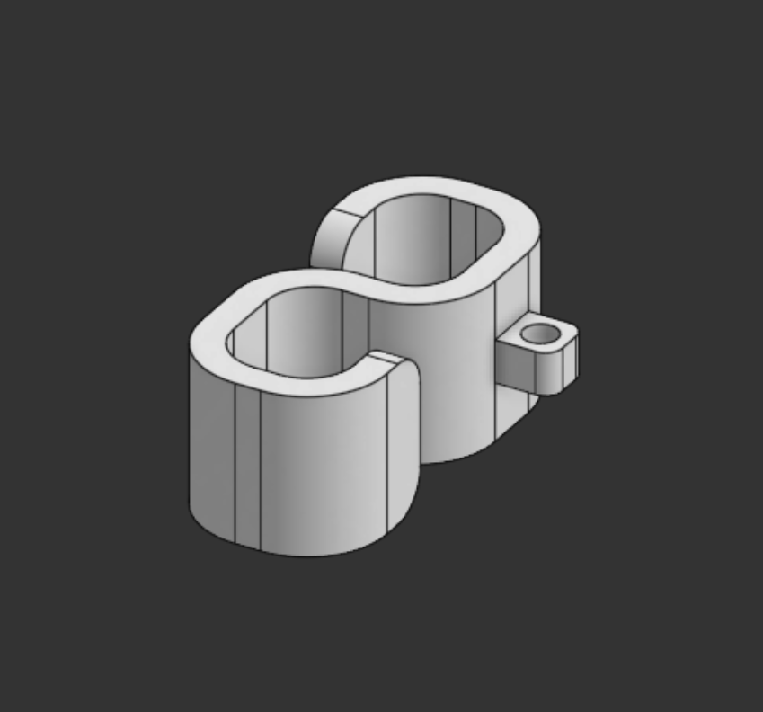
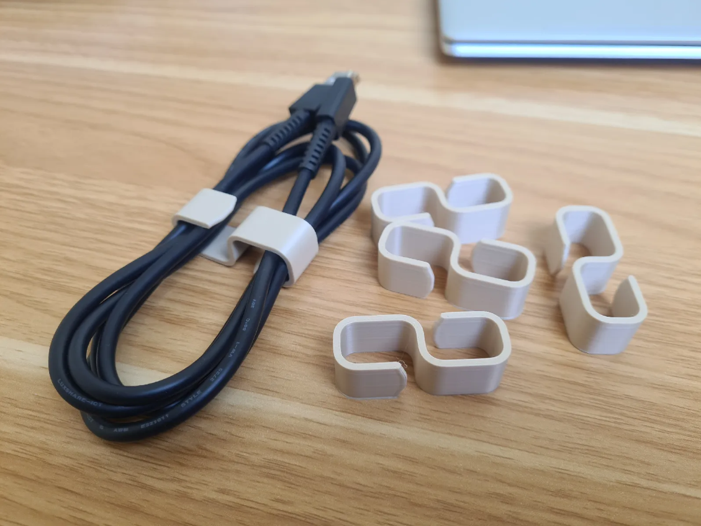
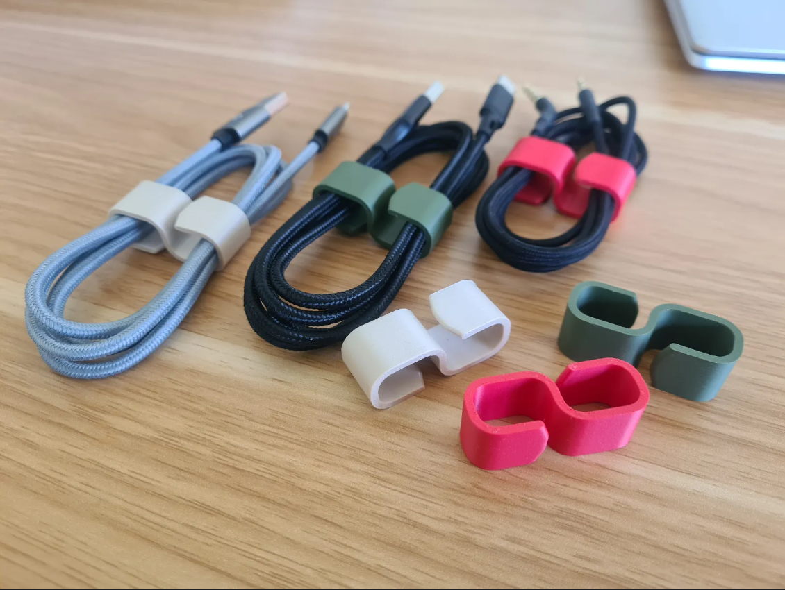

# cync
Cync is a simple 3D-printed accessory to organize your messy cables.

## What is this?
Cync is a very basic and simple cable organizer for different sizes of cables, i.e., with varied diameters and lengths. Cync is designed to be categorized into three types: Small, Medium, and Large. All cable organizers have a holder ring so you can attach a keyring to them for ease of carrying. Cync is designed in Onshape and is to be 3D printed with PLA.





## Repository Structure
```text
cync/
|
|---- Assets/-----------# Images and visual references for the project
|
|---- Hardware/---------# Source design files for the CAD
|
|---- LICENSE-----------# MIT License
|
|---- README.md---------# Project documentation and instructions
```

## Live 3d view in Onshape
Click [here](https://cad.onshape.com/documents/b543ba8c2742f36b66d8b7aa/w/13c482af2e9a0b7d37c2154e/e/a0cdcc29b567236020167490) to view Cync in Onshape!

## How to get your own Cync?
1. Download the source CAD (.step file) from the [Hardware](Hardware/) directory
2. Import the file into your CAD editor and make edits as you want (Optional)
3. Go to your fabricater/ manufacturer website, get a quote, and purchase it (For Example, [ROBU](https://robu.in) or [JLCPCB](https://jlcpcb.com))
4. That's it! Wait for it to arrive and go organize your cables!

   

## [BOM](BOM.csv) as a table
| Item          | Description       | Quantity | Price (USD) | Link                             |
|---------------|-------------------|----------|-------------|----------------------------------|
| Cync 3D print | PLA (30 gm total) | 3        | 1.5         | https://printlegion.hackclub.com |
| Shipping      |                   |          | 1           |                                  |
| Total         |                   |          | 2.5         |                                  |

## Fabrication Specs
1. Printer- 0.2 mm Standard Quality
2. Material- PLA
3. Color- As you like
4. Infill- (60-90)%

## License
[MIT](LICENSE)- Use, modify, share as you like!

## Notes
- If ya'll like this project, make sure to see my other projects [NFC Card](https://github.com/vd-sh/nfc-card), [Deskr](https://github.com/vd-sh/deskr), or [Key Rings](https://github.com/vd-sh/key-rings)
- Or simply visit my [profile](https://github.com/vd-sh) to see the latest projects :)
